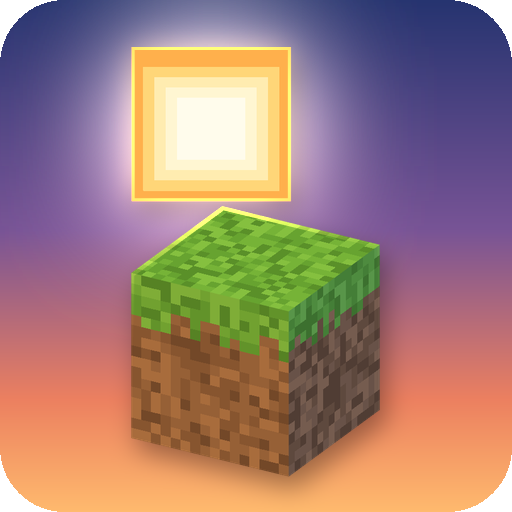
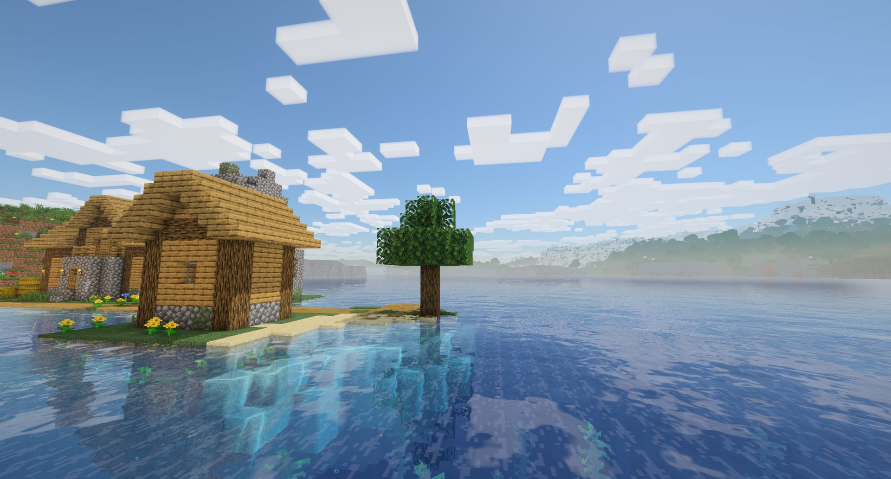
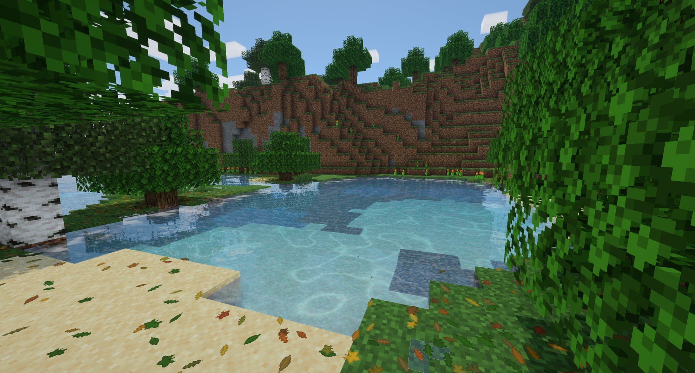
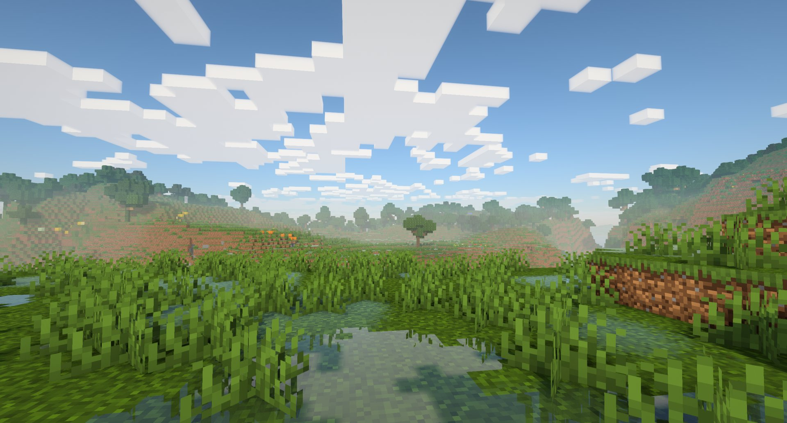
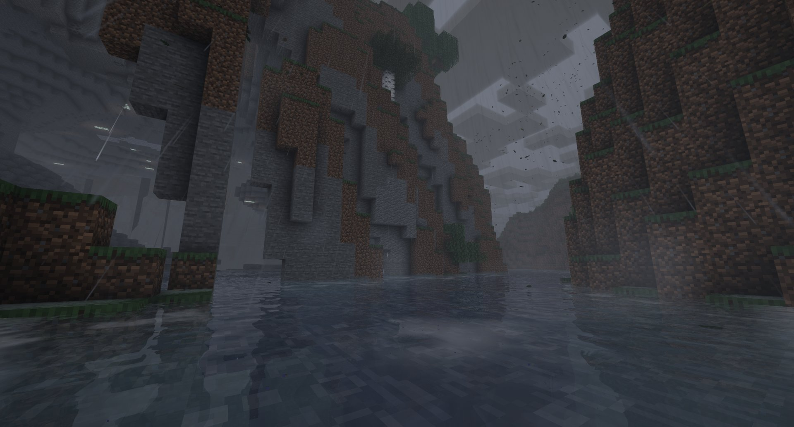
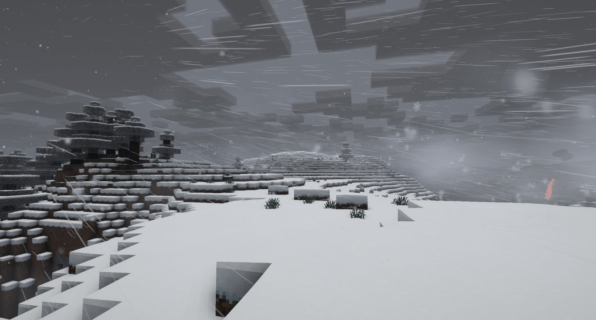
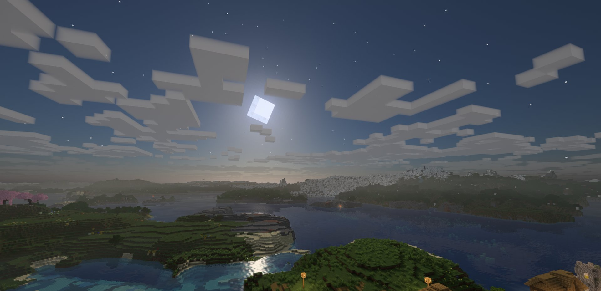

<p align="center">
  
</p>

<h1 align="center">Pocky Shaders</h1>

<p align="center">
  <b>A cosy, natural shader pack for Iris</b> - soft shadows, living water and foliage, juicy sunrises and weather you can feel, while the game still looks like Minecraft. Shows the weather of my rain, snow and leaves mods.
</p>

<p align="center">
  <a href="https://www.minecraft.net"></a>
  <a href="https://www.curseforge.com/minecraft/mc-mods/irisshaders"></a>
  <a href="LICENSE"></a>
</p>

<p align="center">
  
</p>

## Features

- ☀️ **Natural light** - a physically based sky, a warm low sun, soft coloured shadows with crisp pixel edges, and
  colours close to vanilla at noon instead of a repainted world.
- 🌅 **Juicy sunrises and sunsets** on both sides of the sky, a pink dawn, a dark moonlit night.
- ☁️ **Vanilla-shaped clouds with volume** - the game's own cloud pattern as lit 3D cubes that cast shadows; size and
  height adjustable.
- 🌊 **Living water** - refraction, reflections of the world and sky, sun glitter, caustics, shore foam, foaming
  waterfalls, lamp light glowing in the water, a darker sea far from the shore; under water, columns of sunlight and
  caustics dancing over the bottom.
- 🌾 **Waving grass and leaves** with light shining through them - also the leaves, flowers, saplings and crops of
  other mods, which join through the game's block tags.
- ⛈️ **Weather you can feel** - a grey overcast in rain, dark thunderstorms with lightning lighting the clouds, wet
  ground with puddle patches, rainbows after rain.
- 🧱 **Real materials** - every block takes the light by the relief of its own texture; metals shine and mirror the
  sky in their own colour, polished stone and glazed blocks reflect the world, dirt and sand stay matte.
- 🔥 **Warm block light** - flickering torches, glowing lava that looks hot, caves that follow the game's Brightness
  setting; a hazy Nether and a lit End close to vanilla's.
- 🔭 **[Distant Horizons](https://www.curseforge.com/minecraft/mc-mods/distant-horizons) support** - distant land and water shaded like the near world, with shadows.
- 🎚️ **Four quality presets** - Low, Medium, High, Ultra on the Profile button, and every effect on its own switch in
  the shader pack settings.

## Looks best with my visual mods

The mods hand their weather to the pack themselves while it is on - no extra mod needed (their Minecraft 1.21.1 versions; elsewhere the pack shows vanilla weather). Shader pack authors can read it too: [the data format](https://github.com/Pocky-l/pocky-shaders/blob/main/docs/shader-data.md).

[](https://www.curseforge.com/minecraft/mc-mods/petrichor-rain-storms) ✅ **[Petrichor: Rain & Storms](https://www.curseforge.com/minecraft/mc-mods/petrichor-rain-storms)** (1.7.0 or newer) - drizzles, downpours and storms set the sky, light and fog; sun showers, rainbows and wet ground follow its rain; puddles stay still with pixel rain rings; its lightning lights the clouds.

[](https://www.curseforge.com/minecraft/mc-mods/hoarfrost-snow-blizzards) ✅ **[Hoarfrost: Snow & Blizzards](https://www.curseforge.com/minecraft/mc-mods/hoarfrost-snow-blizzards)** (1.4.0 or newer) - blizzards stay bright, not dark: the haze closes in with the storm's visibility and gusts, and the flakes and snow cover take on the pack's light.

[](https://www.curseforge.com/minecraft/mc-mods/rustling-leaves) ✅ **[Rustling Leaves](https://www.curseforge.com/minecraft/mc-mods/rustling-leaves)** (2.6.0 or newer) - grass and crowns sway with the same gust waves that blow the leaves; leaves and litter are shaded like the blocks around them.

[](https://www.curseforge.com/minecraft/mc-mods/turbo-for-distant-horizons) ✅ **[Turbo for Distant Horizons](https://www.curseforge.com/minecraft/mc-mods/turbo-for-distant-horizons)** - the distant land fills in fast, and the pack gives it shadows and water.

## Controls

Iris' own keys: `K` turns the shaders on and off, `R` reloads them, `O` opens the shader pack list.

## Configuration

*Video Settings > Shader Packs > Pocky Shaders > Shader Pack Settings*: the quality preset (Profile) and every effect
(lighting, nature, water, sky, weather, post-processing), each on its own switch or slider. *Weather from Pocky Mods*
there turns the link to the mods above off.

## Compatibility

[](https://www.curseforge.com/minecraft/mc-mods/irisshaders) ✅ **[Iris](https://www.curseforge.com/minecraft/mc-mods/irisshaders)** (required) - the pack runs on Iris; its options are in the Iris shader pack menu.

[](https://www.curseforge.com/minecraft/mc-mods/oculus) ✅ **[Oculus](https://www.curseforge.com/minecraft/mc-mods/oculus)** - the Forge port of Iris for Minecraft 1.20.1 runs the pack too; blocks of other mods sway there only if listed by name (Oculus has no block tags).

[](https://www.curseforge.com/minecraft/mc-mods/sodium) ✅ **[Sodium](https://www.curseforge.com/minecraft/mc-mods/sodium)** - required by Iris, works.

[](https://www.curseforge.com/minecraft/mc-mods/distant-horizons) ✅ **[Distant Horizons](https://www.curseforge.com/minecraft/mc-mods/distant-horizons)** (optional) - LOD terrain and water are lit, shadowed and fogged by the pack.

[](https://www.curseforge.com/minecraft/mc-mods/colorwheel) ✅ **[Colorwheel](https://www.curseforge.com/minecraft/mc-mods/colorwheel)** (optional) - with [Create](https://www.curseforge.com/minecraft/mc-mods/create) and other Flywheel mods, contraptions, water wheels, cogs and trains are drawn by Colorwheel with the pack's light and shadows, so they stay fast and still look like the world around them.

## Installation

1. Install [Iris](https://www.curseforge.com/minecraft/mc-mods/irisshaders) (with [Sodium](https://www.curseforge.com/minecraft/mc-mods/sodium)) for your Minecraft version, 1.20.1 to 26.3 - or
   [Oculus](https://www.curseforge.com/minecraft/mc-mods/oculus) on Forge 1.20.1.
2. Put the zip into the `shaderpacks` folder of your game - do not unzip it.
3. *Video Settings > Shader Packs*: pick **Pocky Shaders**.

Coming from the old Pocky Shaders mod (1.x)? Remove `pocky_shaders-*.jar` from `mods`; the `shaderpacks/Pocky Shaders`
folder it installed can be deleted.

## Building

```sh
python tools/build_pack.py
```

The zip is written to `build/`. `python tools/preview/compile_check.py` compiles every shader program offline.

## Screenshots



*Caustics in a forest pond, with [Rustling Leaves](https://www.curseforge.com/minecraft/mc-mods/rustling-leaves)*



*A wet meadow on a clear morning*



*A thunderstorm over a river canyon, with [Petrichor](https://www.curseforge.com/minecraft/mc-mods/petrichor-rain-storms)*



*A blizzard in the snowy taiga, with [Hoarfrost](https://www.curseforge.com/minecraft/mc-mods/hoarfrost-snow-blizzards)*



*A moonlit night over the coast*

## Credits

- Author: **Pocky**.
- Released under the [MIT](LICENSE) license.

<!-- more-mods:start -->
## More mods by Pocky

**🌦️ Weather & nature**

<table>
  <tr>
    <td width="56"><a href="https://www.curseforge.com/minecraft/mc-mods/hoarfrost-snow-blizzards"></a></td>
    <td><a href="https://www.curseforge.com/minecraft/mc-mods/hoarfrost-snow-blizzards"><b>Hoarfrost: Snow & Blizzards</b></a> - seven kinds of snowfall, a living wind and soft snow on the land (<a href="https://github.com/Pocky-l/hoarfrost">source</a>)</td>
  </tr>
  <tr>
    <td width="56"><a href="https://www.curseforge.com/minecraft/mc-mods/petrichor-rain-storms"></a></td>
    <td><a href="https://www.curseforge.com/minecraft/mc-mods/petrichor-rain-storms"><b>Petrichor: Rain & Storms</b></a> - realistic rain, puddles, drips and branching lightning (<a href="https://github.com/Pocky-l/petrichor">source</a>)</td>
  </tr>
  <tr>
    <td width="56"><a href="https://www.curseforge.com/minecraft/mc-mods/rustling-leaves"></a></td>
    <td><a href="https://www.curseforge.com/minecraft/mc-mods/rustling-leaves"><b>Rustling Leaves</b></a> - falling leaves and leaf piles you can wade through and rake, client-side (<a href="https://github.com/Pocky-l/rustling-leaves">source</a>)</td>
  </tr>
</table>

**💡 Light**

<table>
  <tr>
    <td width="56"><a href="https://www.curseforge.com/minecraft/mc-mods/lumen-rigs"></a></td>
    <td><a href="https://www.curseforge.com/minecraft/mc-mods/lumen-rigs"><b>Lumen Rigs</b></a> - aimable spotlights and floodlights with colored light and visible beams (<a href="https://github.com/Pocky-l/lumen-rigs">source</a>)</td>
  </tr>
  <tr>
    <td width="56"><a href="https://www.curseforge.com/minecraft/mc-mods/neon-glowsticks"></a></td>
    <td><a href="https://www.curseforge.com/minecraft/mc-mods/neon-glowsticks"><b>Neon Glowsticks</b></a> - throwable glowsticks that bounce, roll and light up the dark (<a href="https://github.com/Pocky-l/neon-glowsticks">source</a>)</td>
  </tr>
</table>

**🎨 Graphics & performance**

<table>
  <tr>
    <td width="56"><a href="https://www.curseforge.com/minecraft/mc-mods/turbo-for-distant-horizons"></a></td>
    <td><a href="https://www.curseforge.com/minecraft/mc-mods/turbo-for-distant-horizons"><b>Turbo for Distant Horizons</b></a> - Distant Horizons terrain generated several times faster (<a href="https://github.com/Pocky-l/dhturbo">source</a>)</td>
  </tr>
</table>

**⚔️ Gear & gameplay**

<table>
  <tr>
    <td width="56"><a href="https://www.curseforge.com/minecraft/mc-mods/holy-staff"></a></td>
    <td><a href="https://www.curseforge.com/minecraft/mc-mods/holy-staff"><b>Holy Staff</b></a> - a healing staff with three skills and flying heal numbers (<a href="https://github.com/Pocky-l/holy-staff">source</a>)</td>
  </tr>
  <tr>
    <td width="56"><a href="https://www.curseforge.com/minecraft/mc-mods/ranchers-vacpack"></a></td>
    <td><a href="https://www.curseforge.com/minecraft/mc-mods/ranchers-vacpack"><b>Rancher's Vacpack</b></a> - a Slime Rancher vacuum gun for items and small mobs (<a href="https://github.com/Pocky-l/ranchers-vacpack">source</a>)</td>
  </tr>
</table>

**🔮 Magic**

<table>
  <tr>
    <td width="56"><a href="https://www.curseforge.com/minecraft/mc-mods/hextale"></a></td>
    <td><a href="https://www.curseforge.com/minecraft/mc-mods/hextale"><b>HexTale</b></a> - hextech magic to research, distil and bind with runes, inspired by Arcane and Thaumcraft (<a href="https://github.com/Pocky-l/HexTale">source</a>)</td>
  </tr>
</table>

**⚡ Tech & energy**

<table>
  <tr>
    <td width="56"><a href="https://www.curseforge.com/minecraft/mc-mods/mekanism-advancedgenerators"></a></td>
    <td><a href="https://www.curseforge.com/minecraft/mc-mods/mekanism-advancedgenerators"><b>Mekanism Advanced Generators</b></a> - nine tiers of solar panels, big solar generators, cubes and cables for Mekanism (<a href="https://github.com/Pocky-l/Mekanism-MoreSolarPanels">source</a>)</td>
  </tr>
</table>

**🛠️ Server tools**

<table>
  <tr>
    <td width="56"><a href="https://www.curseforge.com/minecraft/mc-mods/inventory-backups"></a></td>
    <td><a href="https://www.curseforge.com/minecraft/mc-mods/inventory-backups"><b>Inventory Backups</b></a> - inventory and ender chest backups with one-click restore for admins (<a href="https://github.com/Pocky-l/inventory-backups">source</a>)</td>
  </tr>
</table>

<!-- more-mods:end -->

## License

[MIT](LICENSE)
